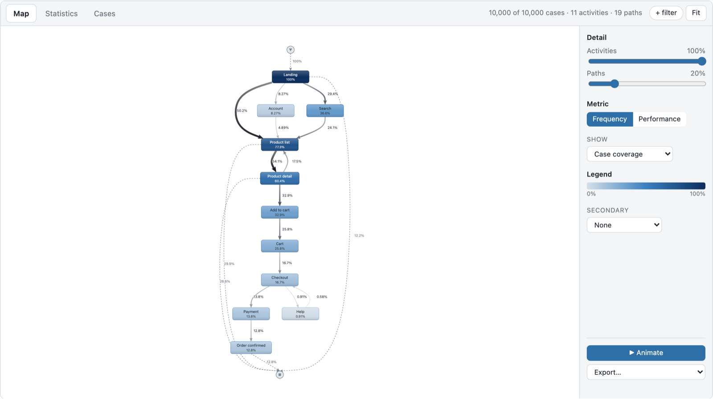
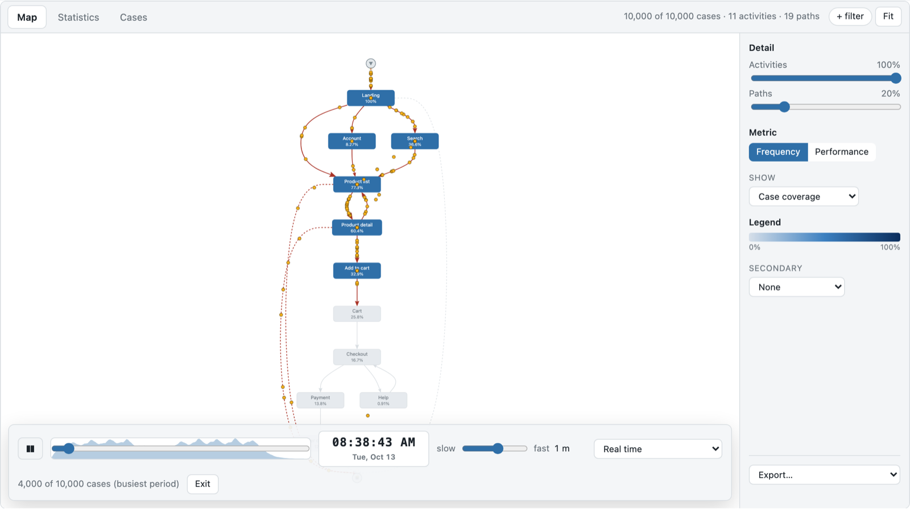
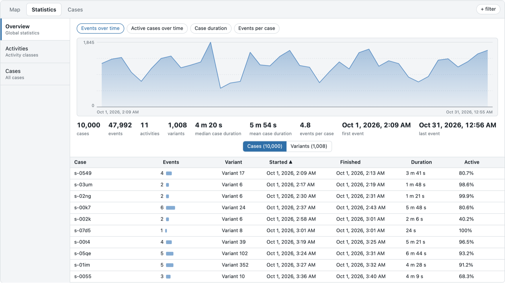

# pathminer

[](https://github.com/sureshHARDIYA/pathminer/actions/workflows/ci.yml)
[](https://www.npmjs.com/package/@pathminer/core)
[](https://www.npmjs.com/package/@pathminer/react)
[](LICENSE)

Process mining for web applications, as a React + TypeScript library.

Feed it the events your app already records (page views, custom events, API calls) and it shows
how people actually move through the product: the process map, the dominant paths, where sessions
drop off, how long each step takes, and a replay of real sessions flowing through the map.

It is built to be embedded in your own product, not to be a product: no server, no database, no
account, one runtime dependency (`@dagrejs/dagre`), and it stays smooth with millions of events.



## What you get

- **Process map** (directly-follows graph) with the conventions practitioners know from desktop process-mining tools: a vertical spine, Start
  and End markers, frequency or performance colouring, activity and path detail sliders, a
  secondary metric, and a popover with the numbers for any node or path.
- **Replay animation**: one token per session moves along the paths at a speed you pick (the
  whole log in 10 s to 10 min); nodes and paths light up as tokens pass.
- **Statistics**: events over time, active cases, case duration and events-per-case charts,
  global numbers, activity table, and a sortable cases/variants table.
- **Cases**: virtualised list of every session with its variant and the full event trace.
- **Filters**: timeframe, keep/remove activities, start and end activities, top variants.
  Controlled or uncontrolled, so the host can persist them in a URL or a store.
- **Export**: PNG, SVG or PDF of the map at the current detail level.
- **Theming**: everything is a `--pm-*` CSS variable; light and dark included.
- **Performance**: a columnar, typed-array event log. One million sessions (4.8 M events) index in
  about a second, filters apply in under 50 ms, replay runs at 60 fps.

| Replay | Statistics |
| --- | --- |
|  |  |

## Packages

| Package | What it is |
| --- | --- |
| [`@pathminer/core`](packages/core) | Framework-free data layer: event-log indexing, CSV/JSON adapters, filters, directly-follows graph, variants, statistics, layered layout. Runs in Node, a worker or the browser. |
| [`@pathminer/react`](packages/react) | Components: `ProcessExplorer` (all-in-one), `ProcessMap`, `StatisticsView`, `CasesView`, `FilterBar`, `ExplorerSkeleton`, plus `ProcessMiningProvider` and hooks. |
| [`apps/demo`](apps/demo) | Vite app with a generated clickstream (10k, 100k or 1M sessions) and two anonymised real logs exported from Azure Application Insights. |

## Install

```bash
pnpm add @pathminer/core @pathminer/react
```

React 18 or 19 is a peer dependency.

## Use

```tsx
import { buildEventLog, fromJson } from "@pathminer/core";
import { ProcessExplorer } from "@pathminer/react";
import "@pathminer/react/styles.css";

// Any rows with a case id, an activity and a timestamp. Here: one row per page view.
const events = fromJson(rows, {
  caseId: "sessionId",
  activity: "path",
  timestamp: "timestamp",
  endTimestamp: "leftAt", // optional: gives activities a duration
  attributes: ["browser", "os"],
});
const log = buildEventLog(events);

export function Sessions() {
  return (
    <ProcessExplorer
      log={log}
      height="80vh"
      map={{ animation: true }}
      onCaseOpen={(id) => router.push(`/sessions/${id}`)}
    />
  );
}
```

For large logs build the `EventLog` in a Web Worker and transfer its buffers; the demo shows how
(`apps/demo/src/worker.ts`). CSV works the same way through `fromCsv`.

### Pulling events from Azure Application Insights

`scripts/export-appinsights.py` is the query we use: page views and custom events from a Log
Analytics workspace, session id as case, URL path as activity (ids collapsed to `:id`), a page
view lasting until the session's next event. Adapt the workspace and app names and you have a log.

## Documentation

The [`knowledge/`](knowledge/README.md) folder is the reference:
[architecture](knowledge/architecture.md), [data model](knowledge/data-model.md),
[core API](knowledge/core-api.md), [React API](knowledge/react-api.md),
[theming](knowledge/theming.md), [performance](knowledge/performance.md),
[demo](knowledge/demo.md), [development](knowledge/development.md), the
[design reference](knowledge/design-reference.md) behind the map conventions and the
[observation notes](knowledge/observations.md) it summarises.

## Develop

```bash
pnpm install
pnpm dev          # demo on http://localhost:5173
pnpm lint         # biome
pnpm typecheck
pnpm test
pnpm build        # both packages to dist/
```

CI runs lint, typecheck, tests, builds and a dependency audit on every push and pull request.
Renovate keeps dependencies current. Pushing a `v*` tag that matches the package versions
publishes both packages to npm with provenance and creates a GitHub release.

## License

[MIT](LICENSE)
