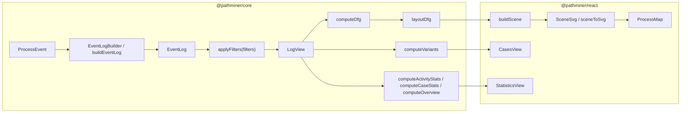
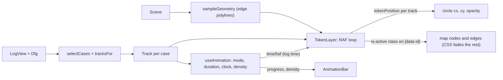

# Architecture

## Workspace layout

pnpm workspace (`pnpm-workspace.yaml`: `packages/*`, `apps/*`).

| Path | Package | Role |
| --- | --- | --- |
| `packages/core` | `@pathminer/core` | Framework-free data handling. Only runtime dependency: `@dagrejs/dagre` (layout). |
| `packages/react` | `@pathminer/react` | React components. Depends on core (`workspace:*`). Peer deps: `react`, `react-dom` >= 18. |
| `apps/demo` | `demo` (private) | Vite app with a generated clickstream. |
| `observations.md` | | Design notes from a reference tool study. |

## Core / react split

- `core` has no React and no DOM use. Its functions are pure and can run in a Web Worker.
- `react` holds state (filters, selection), memoises the derived data, and draws.
- The renderer is split too: `render/scene.ts` (`buildScene`) is pure and has no DOM. `map/SceneSvg.tsx` is the React twin of `sceneToSvg`.
- `react` imports only from `@pathminer/core`.

## Data flow

1. Raw rows become `ProcessEvent` objects (`fromCsv`, `fromJson`) or are written straight into `EventLogBuilder`.
2. `buildEventLog(events)` or `builder.build()` produces an indexed `EventLog` (typed arrays, sorted by case then start time).
3. `applyFilters(log, filters)` produces a `LogView` (a case bitmask over the same log; events are not copied).
4. From a `LogView`, `computeDfg`, `computeVariants`, `computeActivityStats`, `computeCaseStats` and `computeOverview` produce the metrics.
5. `layoutDfg(dfg)` positions nodes and routes edges (dagre).
6. `buildScene(dfg, layout, options)` resolves colours and geometry into a `Scene`.
7. `SceneSvg` (or `sceneToSvg`) emits SVG. Activity nodes and edges carry `data-id` (the node id or the edge id `source>target`); in `SceneSvg` the Start/End markers do not (`sceneToSvg` gives them one).
8. Optional animation (`ProcessMap animation`): `selectCases(view, limit, sampling)` picks the cases and `tracksFor(view, dfg, selection, stretch)` turns them into tracks (hops stretched to stay visible at the chosen speed); `sampleGeometry(scene)` samples each edge path into a polyline; each frame `tokenPosition(track, t, geometry)` gives a point and the node or edge id it is on. See below.

## Where each step runs in the React package

| Component | Derived data |
| --- | --- |
| `ProcessMiningProvider` | `view = applyFilters(log, filters)`, memoised on `[log, filters]`. |
| `ProcessMap` | `computeDfg(view, {activityDetail})` → `selectEdges(edges, detail.paths)` → `layoutDfg` → `buildScene`. |
| `MapAnimation` (inside `ProcessMap`, only while animating) | `useAnimation`: `selectCases` (memoised on view, limit, mode), `tracksFor` (memoised on selection, dfg, factor), `activityDensity`. `TokenLayer`: `sampleGeometry` (memoised on scene). |
| `StatisticsView` | `computeOverview`, `computeActivityStats` or `computeCaseStats` per page. |
| `CasesView` | `computeVariants(view)`; case detail reads the log arrays directly. |

## Animation data flow

- The clock is a ref (`timeRef`). The frame loop in `TokenLayer` reads it and writes SVG attributes directly, so React does not re-render per token. `useAnimation` still sets `progress` each frame while playing, for the bar.
- Mode `realtime` samples the busiest window of cases and plays log time; `synced` samples evenly and shifts every case to start at 0.
- The token overlay is its own `<svg>` above the map with the same pan/zoom transform; the map SVG itself is not redrawn.
- Dimming is CSS under `.pm-map.is-animating`; the `is-active` class is the only per-frame change on map nodes and edges.
