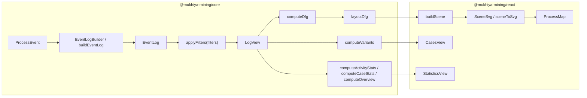

# Architecture

## Workspace layout

pnpm workspace (`pnpm-workspace.yaml`: `packages/*`, `apps/*`).

| Path | Package | Role |
| --- | --- | --- |
| `packages/core` | `@mukhiya-mining/core` | Framework-free data handling. Only runtime dependency: `@dagrejs/dagre` (layout). |
| `packages/react` | `@mukhiya-mining/react` | React components. Depends on core (`workspace:*`). Peer deps: `react`, `react-dom` >= 18. |
| `apps/demo` | `demo` (private) | Vite app with a generated clickstream. |
| `docs/observations.md` | | Design notes from a reference tool study. |

## Core / react split

- `core` has no React and no DOM use. Its functions are pure and can run in a Web Worker.
- `react` holds state (filters, selection), memoises the derived data, and draws.
- The renderer is split too: `render/scene.ts` (`buildScene`) is pure and has no DOM. `map/SceneSvg.tsx` is the React twin of `sceneToSvg`.
- `react` imports only from `@mukhiya-mining/core`.

## Data flow

1. Raw rows become `ProcessEvent` objects (`fromCsv`, `fromJson`) or are written straight into `EventLogBuilder`.
2. `buildEventLog(events)` or `builder.build()` produces an indexed `EventLog` (typed arrays, sorted by case then start time).
3. `applyFilters(log, filters)` produces a `LogView` (a case bitmask over the same log; events are not copied).
4. From a `LogView`, `computeDfg`, `computeVariants`, `computeActivityStats`, `computeCaseStats` and `computeOverview` produce the metrics.
5. `layoutDfg(dfg)` positions nodes and routes edges (dagre).
6. `buildScene(dfg, layout, options)` resolves colours and geometry into a `Scene`.
7. `SceneSvg` (or `sceneToSvg`) emits SVG.

## Where each step runs in the React package

| Component | Derived data |
| --- | --- |
| `ProcessMiningProvider` | `view = applyFilters(log, filters)`, memoised on `[log, filters]`. |
| `ProcessMap` | `computeDfg(view, {activityDetail})` → `selectEdges(edges, detail.paths)` → `layoutDfg` → `buildScene`. |
| `StatisticsView` | `computeOverview`, `computeActivityStats` or `computeCaseStats` per page. |
| `CasesView` | `computeVariants(view)`; case detail reads the log arrays directly. |
